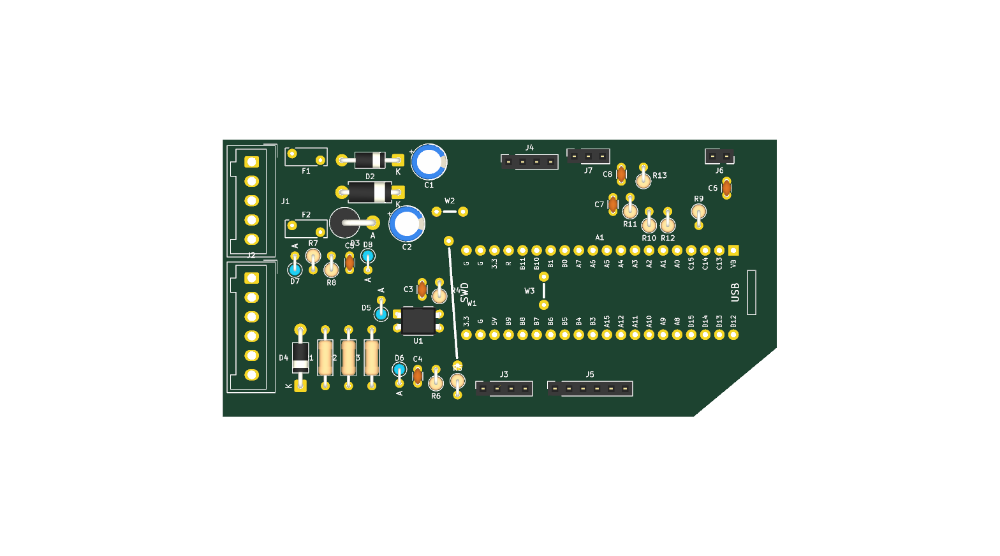

# Control board v2

Redesign of the control board (`Kicad/Placa-control`) focused on **not destroying the electronics
again**. The v1 board was killed through the RPM input, which was wired straight from the ignition
coil to the microcontroller.

- **Single-sided, through-hole only**, for home etching (toner transfer). 3 wire jumpers.
- Same outline as v1 (100 × 50 mm with the chamfered corner), so it fits the original dashboard housing.
- KiCad 10 project with a **complete schematic**: v1 only had a PCB.
- ERC and DRC are clean and run in CI on every change (`.github/workflows/kicad.yml`).

| | |
|---|---|
| Schematic | [docs/control-v2-schematic.pdf](docs/control-v2-schematic.pdf) |
| Layout (copper + silkscreen, seen from the component side) | [docs/control-v2-layout.svg](docs/control-v2-layout.svg) |
| Gerbers, drill file, BOM, toner-transfer PDF | CI artifact `control-board-fab-<sha>` of the **KiCad** workflow |

## Why v1 failed

1. **RPM input.** Coil → diode → 100 kΩ → 100 kΩ ∥ 100 nF ∥ **5.5 V Zener** → PA6.
   - PA6 is a 3.3 V pin, not 5 V tolerant: its absolute maximum is about 3.6 V. The MCU's internal
     protection diodes conducted before the Zener did, and every spark injected current into the
     3.3 V rail.
   - That rail also feeds the displays, the GPS and the Bluetooth module, which is why everything
     died at once.
   - A single small 0204 resistor also had to stand hundreds of volts.
2. **Footprint bug.** One row of the v1 Blue Pill footprint was numbered in reverse. 5 V, GND and the
   RPM signal landed on the wrong module pins and had to be fixed with wires.
3. **No protection on the 12 V input or on the sensor inputs**, and no protection against a
   failing or mis-adjusted regulator preset.

## What's new

| Block | v2 circuit | Protects against |
|---|---|---|
| RPM input | 1N4007 → 3 × 47 kΩ in series → **PC817 optocoupler** (+ 1N4148 across the LED). Output to PA6 through 1 kΩ, 1 nF filter, internal pull-up | Coil voltage never reaches the MCU (galvanic isolation through the opto); negative pulses; resistor over-voltage |
| | 2.5 mm clearance from the coil nets to everything else (custom DRC rule, applied to the GND pour too); empty connector pins on both sides of the coil input | Arcing and creepage |
| 12 V input | PTC fuse 0.5 A / 60 V → 1N5819 (reverse polarity) → P6KE22A TVS + 47 µF | Shorts, reversed battery, load-dump spikes (clamped to ~31 V, below the 40 V limit of LM2596 modules) |
| 5 V rail | PTC fuse 0.5 A → **1N5340B 6 V / 5 W Zener crowbar** + 100 µF | A failed or mis-adjusted regulator preset: the Zener conducts and the PTC trips instead of 12 V reaching the modules |
| Wheel speed (PA8) | 4.7 kΩ pull-up to 5 V (switch to GND), 10 kΩ series, 100 nF, 4.7 V Zener | Shorts to 12 V, spikes, contact bounce |
| Fuel level (PA7) | 5 V → 1N4148 → 150 Ω divider with the sender, 10 kΩ series, 100 nF, 3.3 V Zener | Sender wire touching 12 V (no back-feed into 5 V), spikes |
| Button (PA0) | 1 kΩ series + 100 nF (internal pull-up) | ESD, bounce |
| LED bars | 10 kΩ / 8.2 kΩ / 1 µF PWM filters (full scale ≈ 1.5 V for the LM3915) | — |

## Connectors

| Ref | Type | Pin 1 → n |
|---|---|---|
| J1 POWER | Wago 734-135 (5 pins) | 1 +12 V (after the ignition switch), 2 GND, 3 to regulator IN+, 4 regulator GND (IN− / OUT−), 5 from regulator OUT+ |
| J2 SENSORS | Wago **734-136 (6 pins)** | 1 fuel sender, 2 *empty*, 3 **ignition coil**, 4 *empty*, 5 wheel switch, 6 GND |
| J3 DISPLAYS | 1×4 socket | 1 GND, 2 +5 V, 3 SDA (PB9), 4 SCL (PB8) |
| J7 LED BARS | 1×3 socket | 1 BAR1 (PA2), 2 GND, 3 BAR2 (PA1) |
| J4 GPS | 1×4 socket | 1 GND, 2 TX → PB11, 3 RX ← PB10, 4 VCC (+5 V) |
| J5 BLUETOOTH | 1×6 socket | 1 EN (n.c.), 2 VCC (+5 V), 3 GND, 4 TXD → PA10, 5 RXD ← PA9, 6 STATE (n.c.) |
| J6 BUTTON | 1×2 socket | 1 button (to PA0), 2 GND |

- **Display board wiring changes.** The old 6-wire cable is replaced by J3 (OLEDs) and J7 (LM3915
  inputs), so the display board needs rewiring.
- **The RPM wire goes to the coil primary**, the low-voltage terminal driven by the CDI. Never connect
  it to the spark plug lead.
- **The external step-down module:** IN+ on J1-3, OUT+ on J1-5, and its common GND on J1-4.
  **Adjust it to 5.0 V before connecting it.**

## Wire jumpers

The board is single-sided, so three crossings are made with insulated wire on the component side.
They are drawn on the silkscreen as `W1`–`W3`:

| Ref | Net | Where |
|---|---|---|
| W1 | +5V | Long diagonal on the left of the Blue Pill (feeds the module, displays and Bluetooth) |
| W2 | GND | Short, above the left end of the Blue Pill |
| W3 | GND | **Under the Blue Pill** (between the two socket rows): install it before the sockets |

## Assembly notes

- Parts under the Blue Pill must be lower than ~7 mm. Only W3 is there; use standard 8.5 mm female headers.
- The `BluePill_Socketed` footprint prints the pin names next to each pad. **Compare them with the
  labels on your module before soldering the headers.** USB goes towards the right edge, SWD towards
  the left.
- R1–R3: use 1/4 W metal-film resistors (≥ 250 V). The PTCs are 5.1 mm radial, rated 60 V (RXEF050,
  MF-R050 or similar).
- Wago 734 pins are 1 mm square: drill the J1/J2 holes with 1.3–1.5 mm.
- A conformal coating (or clear nail polish) over the RPM area improves creepage in a damp environment.

## Bring-up checklist

1. Without the Blue Pill or any module plugged in, power J1-1 from a bench supply (12 V,
   current-limited to ~200 mA). Check about 11.6 V on J1-3 (regulator input).
2. Connect the step-down module and check **5.0 V** on J3-2 / J4-4 / J5-2.
3. Plug the Blue Pill, then the displays, GPS and Bluetooth one at a time.
4. On the bike, check the RPM input with the engine at idle: PA6 should show clean low pulses.
   A scope is ideal.

## Firmware

The pins are the same as v1, but some inputs work differently. The firmware and the `.ioc` are
already set up for this board:

| Pin | Board v2 behaviour | Firmware |
|---|---|---|
| PA6 (RPM) | Digital pulse from the optocoupler, low on every spark | TIM3_CH1 input capture (100 kHz, falling edge, internal pull-up, digital filter). `rpm.c` ignores edges closer than 2 ms (ignition ringing) and reports 0 after 500 ms without sparks. Set `RPM_SPARKS_PER_2_REV` in `rpm.h` for your CDI. |
| PA7 (fuel) | About 0.2 V (full) … 1.7 V (reserve), 10 kΩ source impedance | ADC2 with 239.5-cycle sampling. Calibrate `GAS_RAW_FULL` / `GAS_RAW_RESERVE` in `gas.h` with the raw value shown on the display. |
| PA8 (speed) | External pull-up, the switch pulls it low | No internal pull. |
| PA0 (button) | Internal pull-up | Unchanged. |

## Design rules

- Net classes are defined in `control.kicad_pro`:
  - **Default:** 0.6 mm tracks, 0.4 mm clearance.
  - **Power:** 1.0 mm tracks.
  - **HV:** the coil nets, 0.8 mm tracks.
- The 2.5 mm HV clearance is a custom rule in `control.kicad_dru`. It excludes the empty connector pins.
- The Blue Pill footprint declares its internally connected pins (GND 19/20/22, 3V3 18/21) as pad
  groups, so the DRC knows the module ties them together.
- The GND pour is part of the design. After editing, refill zones (`B`) before running the DRC.

## Fabrication

- **Toner transfer.** Print `control-copper-bottom.pdf` from the CI artifact **at 100 % scale and
  without mirroring**, and transfer it face-down onto the copper. Check the orientation with the
  Blue Pill footprint before etching.
- **Ordering the board.** The CI artifact also contains single-sided Gerbers and the Excellon drill file.
