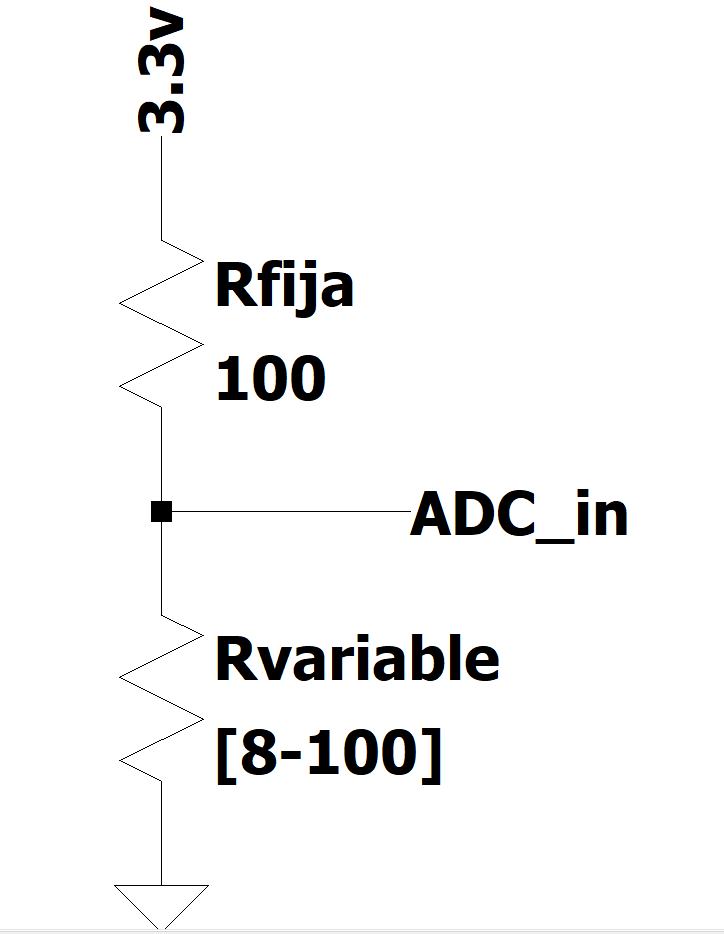
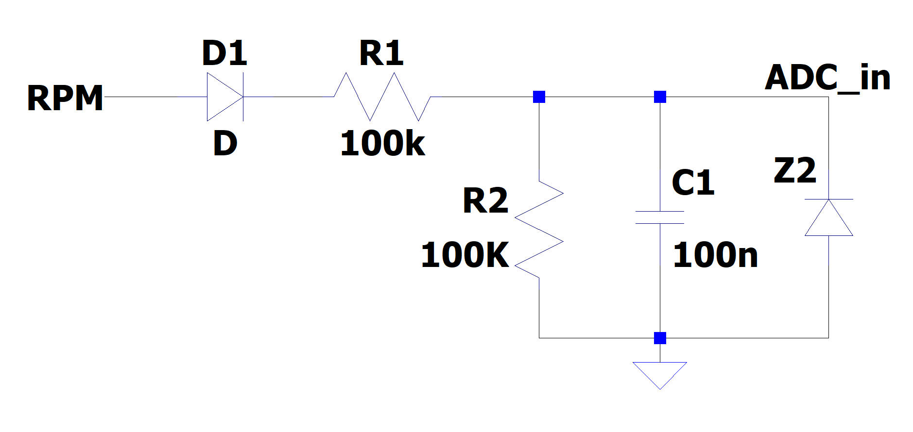
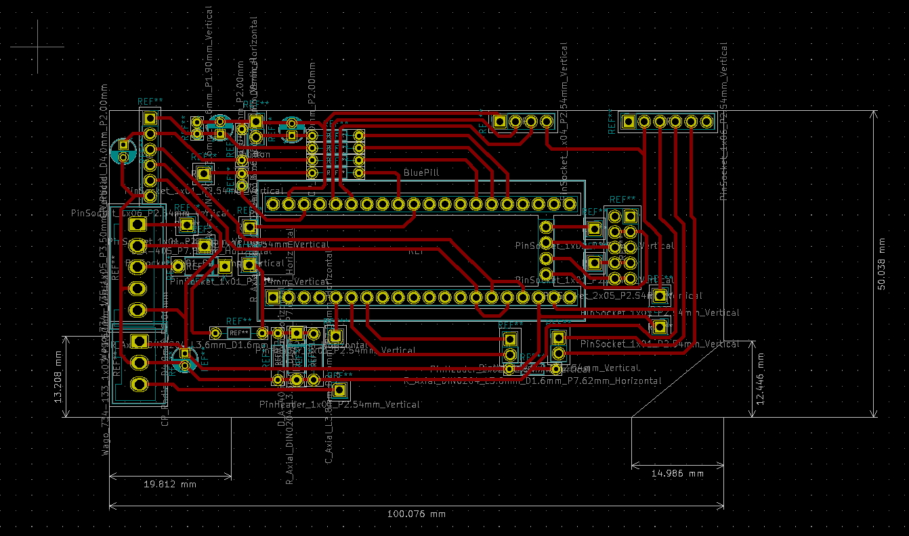
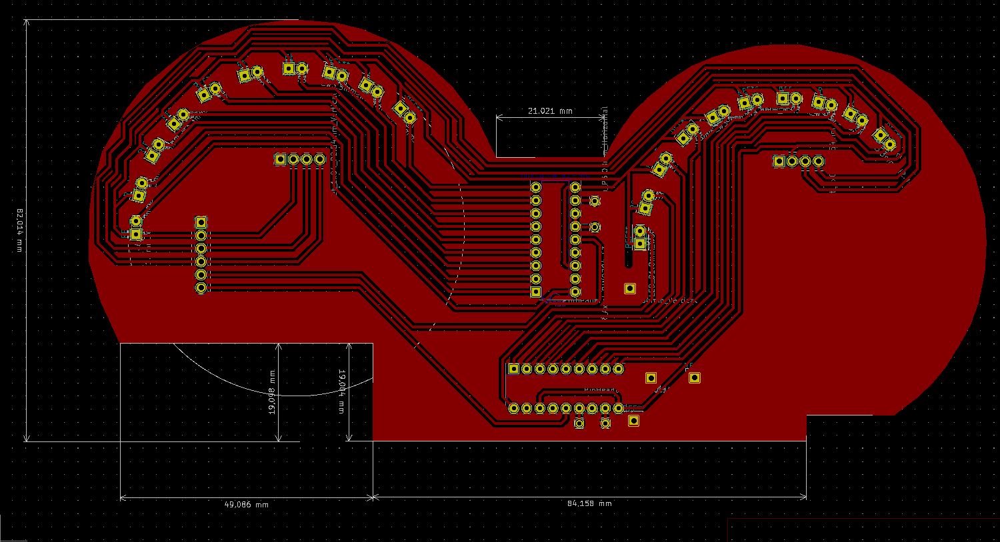

# Motorcycle On-Board Computer

[](https://github.com/Mechanix97/Ordenador-de-abordo/actions/workflows/build.yml)

A digital instrument cluster for a **Zanella RX 150** motorcycle that replaces the original analog
gauges. It measures **speed, engine RPM, fuel level and GPS position** and shows them on two OLED
displays, together with two LED bar graphs that can be read at a glance while riding.

Built on an STM32F103 "Blue Pill" with the STM32Cube HAL, on two home-made PCBs (toner transfer)
designed in KiCad to fit inside the original dashboard housing.

[](https://www.youtube.com/watch?v=SR3X2kFW1ZU)

> Final project for *Seminario de Sistemas Embebidos*, Facultad de Ingeniería, Universidad de Buenos
> Aires (FIUBA), developed between November 2020 and March 2021. The project is being revived:
> see the [open issues](https://github.com/Mechanix97/Ordenador-de-abordo/issues) for the roadmap.

## Features

| Measurement | How it works | Status |
|---|---|---|
| Speed | Wheel switch → external interrupt, pulse counter | Shows raw pulse count ([#5](../../issues/5)) |
| Engine RPM | Rectified ignition signal → RC filter + Zener → ADC | Raw ADC value, uncalibrated ([#6](../../issues/6)) |
| Fuel level | Tank float sender (8–100 Ω) in a resistive divider → ADC | Raw ADC value ([#6](../../issues/6)) |
| GPS position, date, time | u-blox NEO-6M over UART + DMA, `$GPRMC` parsing | Working, accuracy < 10 m; known parser bugs ([#1](../../issues/1)–[#3](../../issues/3)) |
| LED bar graphs | 2 × LM3915 driven by filtered PWM, 10 LEDs each | Hardware works; firmware keeps them off |
| Push button | External interrupt | Counter only ([#7](../../issues/7)) |
| Bluetooth | HC-05 on USART1 | Used for debug output |

Display layout:

- **SH1106 (1.3")**: `VEL` (speed), `RPM`, `GAS` (fuel).
- **SSD1306 (0.96")**: `BUT` (button counter), `LAT`, `LON`, `DAT` (date), `TIME` (UTC-3).

## Hardware

### Components

| Component | Part | Interface |
|---|---|---|
| Microcontroller | STM32F103 "Blue Pill" (Cortex-M3, 72 MHz) | — |
| Display 1 | SH1106 128×64 OLED, 1.3" (I2C address `0x78`) | I2C1 |
| Display 2 | SSD1306 128×64 OLED, 0.96" (I2C address `0x7A`) | I2C1 |
| LED bar graphs | 2 × LM3915 + 20 LEDs | TIM2 PWM |
| GPS | u-blox NEO-6M module | USART3, 9600 baud |
| Bluetooth | HC-05 module | USART1, 9600 baud |

The project targets the `STM32F103CBTx` (128 KB flash). The firmware is about 24 KB, so it also fits
the more common STM32F103C8 (64 KB) found on most Blue Pill boards.

### Pinout

| Pin | Function | Peripheral |
|---|---|---|
| PA0 | Push button | EXTI0, rising edge, pull-up |
| PA1 | LED bar graph 2 | TIM2_CH2 PWM |
| PA2 | LED bar graph 1 | TIM2_CH3 PWM |
| PA6 | Engine RPM | ADC1_IN6 |
| PA7 | Fuel level | ADC2_IN7 |
| PA8 | Wheel-speed sensor | EXTI8, rising edge, pull-down |
| PA9 / PA10 | HC-05 Bluetooth TX / RX | USART1 |
| PB8 / PB9 | OLED SCL / SDA | I2C1 (remapped), 400 kHz |
| PB10 / PB11 | GPS TX / RX | USART3, RX via DMA |
| PA13 / PA14 | SWDIO / SWCLK | Debug |

The full configuration lives in [`Ordenador-abordo.ioc`](Ordenador-abordo.ioc) (STM32CubeMX).

### Sensor interfaces

| Fuel level | Engine RPM |
|---|---|
|  |  |
| The float sender goes from 100 Ω (reserve) to 8 Ω (full). With a 100 Ω pull-up the ADC reads roughly 100–2048 out of 4095. | The ignition signal is rectified, divided and filtered; a 5.5 V Zener protects the ADC pin from ignition spikes. The reading grows with RPM but is not calibrated yet. |

The speed sensor is a simple switch that closes once per wheel revolution.

### PCBs

Two boards, designed in KiCad 5.1 ([`Kicad/`](Kicad)) and made at home by toner transfer.

| Control board (100 × 50 mm) | Display board |
|---|---|
|  |  |
| Blue Pill carrier, Wago terminal blocks for the bike harness, signal conditioning, headers for the GPS and Bluetooth modules. | Shaped to fit the original gauge housing: two arcs of 10 LEDs driven by LM3915s, and headers for both OLED displays. |

> The `.sch` schematic files are empty; only the PCB layouts exist. Rebuilding the schematics is
> tracked in [#15](../../issues/15).

## Building

### Requirements

- [Arm GNU Toolchain](https://developer.arm.com/downloads/-/arm-gnu-toolchain-downloads) (`arm-none-eabi-gcc`)
- GNU Make
- [stlink-tools](https://github.com/stlink-org/stlink) (`st-flash`) and an ST-Link V2 for flashing

**Ubuntu / Debian**

```sh
sudo apt-get install build-essential gcc-arm-none-eabi libnewlib-arm-none-eabi stlink-tools
```

**Windows**: install [STM32CubeCLT](https://www.st.com/en/development-tools/stm32cubeclt.html) (includes
the toolchain) and GNU Make (e.g. `choco install make`). If the toolchain is not on `PATH`, pass it
explicitly: `make GCC_PATH="C:/ST/STM32CubeCLT_x.y.z/GNU-tools-for-STM32/bin"`.

### Commands

```sh
make all     # build build/Ordenador-abordo.{elf,hex,bin}
make clean   # remove build/
make erase   # erase the MCU flash
make flash   # write build/Ordenador-abordo.bin at 0x08000000
```

Connect the ST-Link to the SWD header of the Blue Pill (3.3V, SWDIO, SWCLK, GND).

Every push and pull request is built by [GitHub Actions](.github/workflows/build.yml); the
`.elf`/`.hex`/`.bin` files can be downloaded from the run's artifacts.

## Repository layout

```
Core/            Application code (app.c, gps.c, rpm.c, gas.c), OLED drivers, CubeMX-generated init code
Drivers/         STM32F1 HAL and CMSIS (vendor code, do not edit)
Kicad/           PCB designs: Placa-control (control board) and Placa-pantallas (display board)
docs/images/     Images used in this README
Makefile         Build script (generated by CubeMX, extended with flash/erase targets)
Ordenador-abordo.ioc   STM32CubeMX project
AGENTS.md        Guidelines for AI coding agents working on this repo
```

## Roadmap

Planned improvements are tracked as [GitHub issues](https://github.com/Mechanix97/Ordenador-de-abordo/issues), including:

- Robust GPS reception and NMEA parsing, timezone fixes ([#1](../../issues/1)–[#4](../../issues/4))
- Real speed in km/h, odometer and trip meter ([#5](../../issues/5))
- Calibrated RPM and fuel readings, driving the LED bar graphs ([#6](../../issues/6))
- Watchdog and robustness for an automotive environment ([#11](../../issues/11))
- Host-side unit tests ([#16](../../issues/16)) and KiCad schematics, Gerbers and BOM ([#15](../../issues/15))
- A 3D-printed enclosure and GPS navigation features

## License

No license has been chosen yet ([#18](../../issues/18)). Note that the OLED drivers in `Core/` are
GPL-3.0 and the ST HAL/CMSIS in `Drivers/` are BSD-3-Clause / Apache-2.0.

## Author

Lucas Alexis Rack ([@Mechanix97](https://github.com/Mechanix97))
